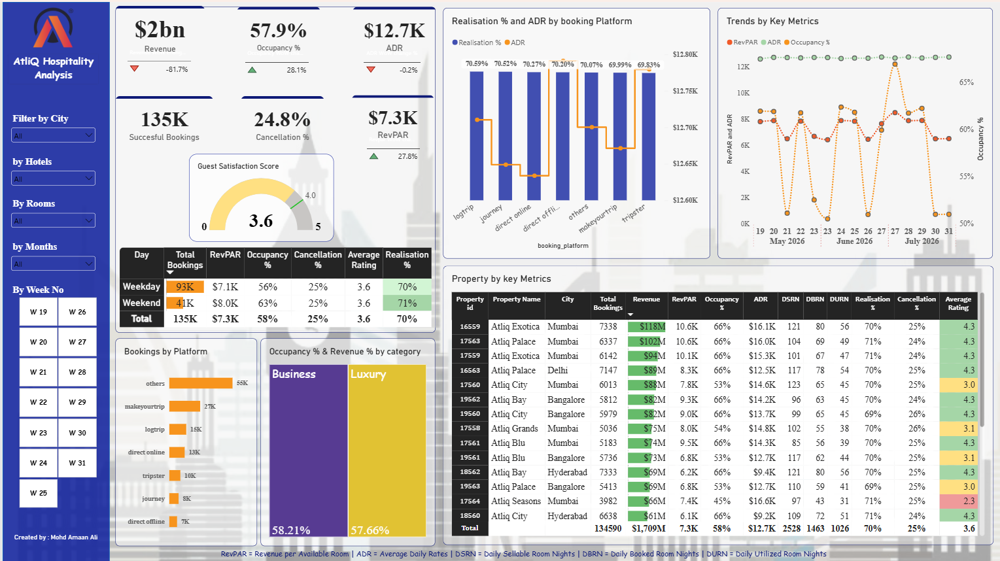
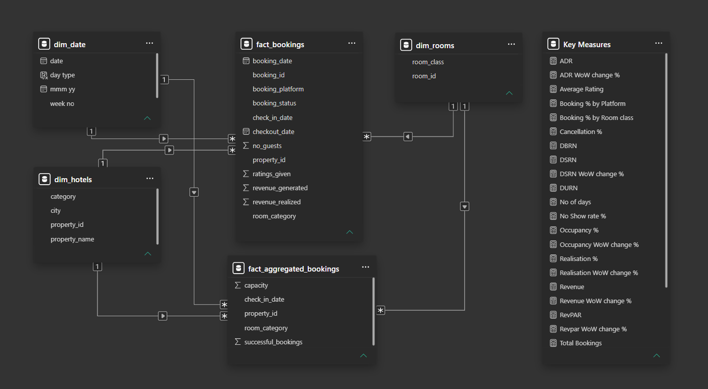

# AtliQ Grands: Hospitality Performance Analytics | Power BI, SQL
> Data-Driven Insights for Revenue Optimization
---

🔗 **Live Power BI Dashboard:**   [Click to View](https://app.powerbi.com/view?r=eyJrIjoiNmFkN2YwYTMtMmMyNy00OTk3LTlmYzgtMmYzYjg4NDZiZDdkIiwidCI6ImM2ZTU0OWIzLTVmNDUtNDAzMi1hYWU5LWQ0MjQ0ZGM1YjJjNCJ9)

---

## 📌 Project Overview

AtliQ Grands is a luxury hotel chain operating across major cities in India. Due to increasing competition and declining market share, the management sought a data-driven solution to monitor business performance and identify opportunities for revenue growth.

This project focuses on analyzing hotel performance using Power BI, providing valuable insights into revenue, occupancy, pricing, customer satisfaction, booking channels, and operational efficiency.

The dataset included:
- 120,000+ booking records  
- 4 city properties  
- 3 months of data  
- Multiple room categories and booking platforms  

This created challenges in identifying revenue trends, seasonal demand, and property-level performance.

### Task

Develop a structured and interactive analytics dashboard to:

- Track overall revenue performance  
- Monitor operational KPIs (Occupancy %, ADR, RevPAR, Realization %)  
- Compare property and city-level performance  
- Identify seasonal demand patterns  
- Enable data-driven pricing and revenue strategy decisions  

### Action

- Extracted and validated structured booking and revenue data using **SQL**
- Cleaned and transformed **100K+ records** using **Power Query**
- Built a **Star Schema data model** with fact and dimension tables
- Created **25+ DAX measures**, including:
  - Total Revenue
  - Occupancy %
  - ADR (Average Daily Rate)
  - RevPAR (Revenue per Available Room)
  - Realization %
  - Revenue Growth %
- Designed an interactive **Power BI dashboard** with:
  - Property-level filters
  - Week and month slicers
  - Room category segmentation
  - Drill-through and trend analysis visuals
- Structured KPI cards for executive-level reporting

### Result

- Identified properties operating at **75%+ average occupancy**
- Discovered **18–22% revenue growth during peak seasons**
- Highlighted underperforming properties with lower RevPAR
- Reduced manual reporting effort by approximately **60%**
- Delivered an executive-ready dashboard enabling faster strategic decisions

---

## 🛠 Tools & Technologies Used

- **Microsoft Power BI**
- **SQL** – Data extraction and validation
- **Power Query** – Data cleaning and transformation
- **Data Modeling** – Fact and dimension table design
- **DAX** – KPI calculations and time intelligence
- Interactive filters, drill-downs, and executive reporting views

---

## 📈 Dashboard Capabilities

### 🔹 Revenue & Occupancy Analysis
- Tracks monthly and seasonal performance trends
- Monitors occupancy fluctuations
- Evaluates revenue growth patterns

### 🔹 Pricing & Demand Insights
- Analyzes ADR performance
- Examines relationship between demand and revenue
- Identifies high-demand vs low-demand periods

### 🔹 Financial Performance Monitoring
- Revenue vs cost tracking
- Profitability trend analysis
- Market-level performance comparison

### 🔹 Executive Summary View
- Consolidated KPI overview
- High-level performance tracking for leadership teams

---

## 🖼️ Project Visuals

---

## 💡 Business Value Delivered

This solution enables:

- Better pricing decisions based on demand patterns  
- Improved monitoring of occupancy performance  
- Clear understanding of revenue drivers  
- Data-backed strategic planning for hospitality management  

---

## 🚀 Why This Project Matters

This project demonstrates the ability to translate business requirements into structured analytical solutions using Power BI. It reflects core competencies required for Data Analyst and Business Intelligence roles, including technical execution, analytical thinking, and business-focused reporting. **[View Project Presentation](https://lnkd.in/p/gDsENdeU)**

💬 Take a look at the dashboard, and feel free to connect on **[LinkedIn](https://www.linkedin.com/in/amaan-ali-ds/)** Always open to feedback, collaboration or new opportunities.
